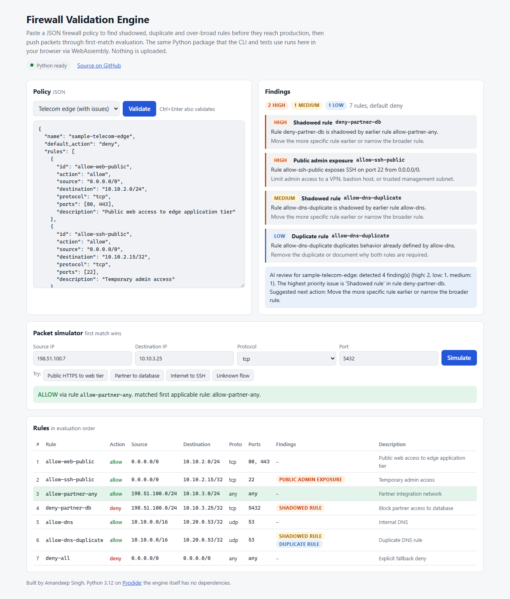

# AI-Assisted Firewall Validation Engine

[](https://github.com/amandesi13/AI-Assisted-Firewall-Validation-Engine/actions/workflows/tests.yml)
[](https://amandesi13.github.io/AI-Assisted-Firewall-Validation-Engine/)
[](https://www.python.org/)
[](pyproject.toml)
[](LICENSE)

**[Live demo](https://amandesi13.github.io/AI-Assisted-Firewall-Validation-Engine/)**: validate a policy and simulate packets in your browser. The real engine runs client-side on Pyodide (WebAssembly), so nothing is uploaded.

[](https://amandesi13.github.io/AI-Assisted-Firewall-Validation-Engine/)

A Python-based firewall rule validation engine that simulates packet flow, detects risky rule behavior, and generates human-readable review notes for security and network engineering workflows.

The project is designed around the kind of validation work used in production telecom and infrastructure environments: deterministic rule evaluation first, explainable anomaly detection second.

## What It Does

- Simulates first-match firewall rule execution.
- Validates JSON firewall policies before deployment.
- Detects common anomalies:
  - shadowed rules
  - duplicate rules
  - broad `any -> any` allow rules
  - public exposure of admin ports
  - missing default deny behavior
  - deny rules made ineffective by earlier allows
- Produces AI-style review guidance without requiring an external API.
- Exports validation reports as text or JSON.
- Includes tests, Docker support, and GitHub Actions CI.

## Quick Start

```powershell
python -m venv .venv
.\.venv\Scripts\python.exe -m pip install -e .[dev]
.\.venv\Scripts\python.exe -m firewall_validation_engine validate samples\policy.json
```

On macOS/Linux:

```bash
python -m venv .venv
. .venv/bin/activate
python -m pip install -e ".[dev]"
python -m firewall_validation_engine validate samples/policy.json
```

## Example

```bash
python -m firewall_validation_engine validate samples/policy.json --format text
```

Output:

```text
Policy: sample-telecom-edge
Default action: deny
Rules: 7
Findings: 4

[HIGH] Public admin exposure
Rule allow-ssh-public allows TCP port 22 from 0.0.0.0/0.

[MEDIUM] Shadowed rule
Rule deny-partner-db is shadowed by earlier rule allow-partner-any.
```

The validator exits with status code `1` when high or critical findings exist, which makes it useful as a CI/CD quality gate.

## Simulate A Packet

```bash
python -m firewall_validation_engine simulate samples/policy.json `
  --src 203.0.113.10 `
  --dst 10.10.2.15 `
  --protocol tcp `
  --port 443
```

## Policy Format

```json
{
  "name": "sample-telecom-edge",
  "default_action": "deny",
  "rules": [
    {
      "id": "allow-web",
      "action": "allow",
      "source": "0.0.0.0/0",
      "destination": "10.10.2.0/24",
      "protocol": "tcp",
      "ports": [80, 443],
      "description": "Allow public web traffic"
    }
  ]
}
```

Supported values:

- `action`: `allow` or `deny`
- `source` / `destination`: CIDR blocks or `any`
- `protocol`: `tcp`, `udp`, `icmp`, or `any`
- `ports`: list of ports, `"any"`, or omitted for non-port protocols

## Docker

```bash
docker build -t firewall-validation-engine .
docker run --rm firewall-validation-engine validate samples/policy.json
```

## Project Structure

```text
src/firewall_validation_engine/
  analyzer.py      anomaly detection
  advisor.py       AI-style review summaries
  cli.py           command-line interface
  evaluator.py     packet simulation engine
  models.py        policy data model
  parser.py        JSON policy loader
tests/
  test_engine.py
samples/
  policy.json
```

## Why This Project Matters

Firewall rule sets grow over time and often contain hidden risk: broad allows, unreachable deny rules, inconsistent intent, and rules that look correct in isolation but behave differently in sequence.

This engine demonstrates how deterministic validation and AI-assisted review can work together:

1. The rule engine explains what the firewall will actually do.
2. The analyzer identifies risky or redundant behavior.
3. The advisor translates findings into review notes a developer or security engineer can act on.

## Browser demo

`web/` holds a static page that loads this package into [Pyodide](https://pyodide.org) and calls
`web/bridge.py` (JSON in, JSON out; covered by `tests/test_web_bridge.py`). The `demo` workflow
builds it with `python web/build_site.py` and deploys it to GitHub Pages on every push to `main`.

```bash
python web/build_site.py _site
python -m http.server -d _site 8000   # http://localhost:8000
```
